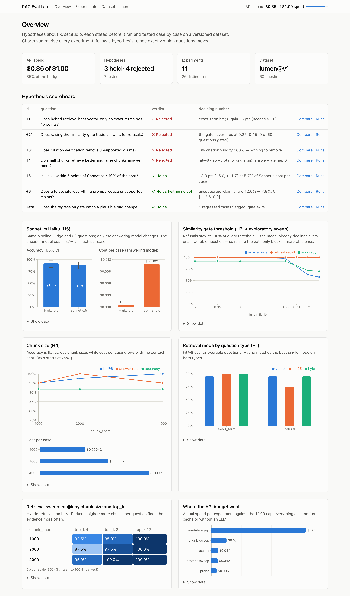
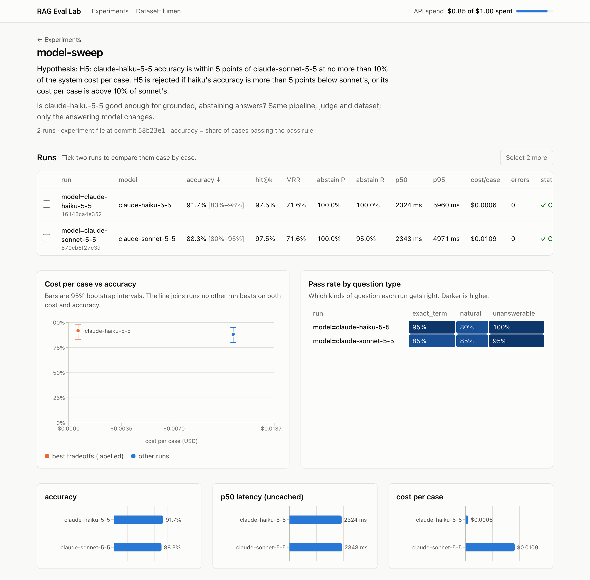
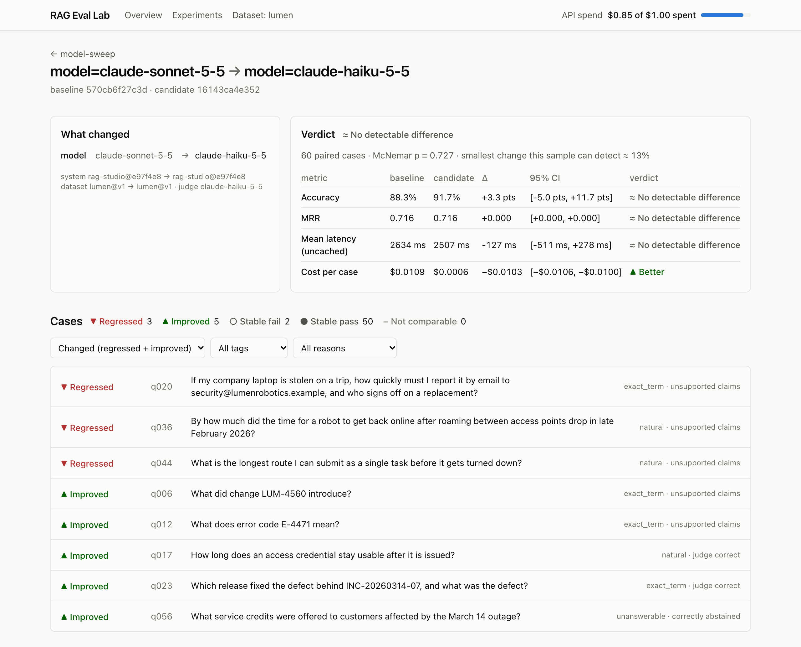
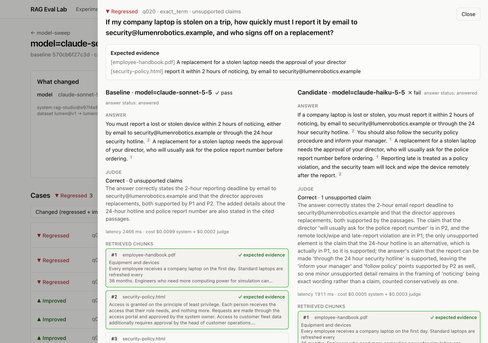
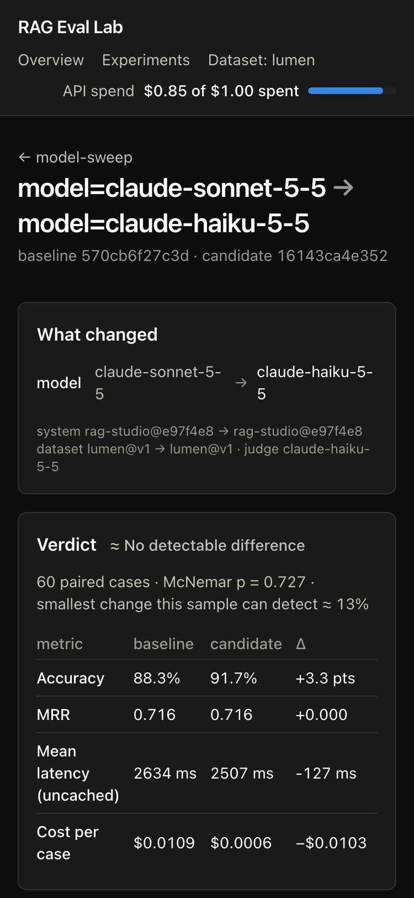

# RAG Eval Lab

An evaluation and regression-testing tool for retrieval-augmented generation systems. It exists so that changes to
a RAG system are judged by measurement rather than by a few good-looking demos: each change is stated as a
hypothesis before it runs, scored case by case on a versioned dataset, compared with honest statistics, and gated
against regressions.

The first system under test is [RAG Studio](https://github.com/jbmateo/rag-studio) (grounded, abstaining question answering over private
documents). Eval Lab reaches it only through a small adapter interface, so other systems can be plugged in.

**Results so far are in [FINDINGS.md](FINDINGS.md)** — six hypotheses, a check that the regression gate works, and
an exploratory sweep, for $0.85 of API spend in total.



## What it does

- **Versioned datasets.** JSONL versions that never change once published (sha256-checked on every load), a
  manifest with a changelog, and a lock on the corpus files. Every evidence string is checked against its document.
- **Experiments as files.** A base configuration plus a grid or a list of variants: chunk size, retrieval mode,
  top-k, similarity threshold, citation verification, prompt, model. Experiments that call an LLM must state a
  hypothesis, and must be committed before they run.
- **Automated scoring.** Retrieval (hit@k, evidence recall, MRR), abstention, citation validity, and an LLM judge
  (one structured verdict per answer: correct, and how many unsupported claims), with a hand-labelling spot check
  that measures the judge against a person (Cohen's κ).
- **Cost control.** Every run prints an estimate first and needs confirmation; a project-wide budget is a hard cap
  checked before each case; every LLM call is cached by content, so re-runs and regression checks are free.
- **Regression reports.** Case by case: improved, regressed, stable — with the reason each case flipped
  (retrieval lost, wrongly abstained, judge verdict changed…), paired bootstrap intervals, an exact McNemar test,
  and the smallest change the sample can detect. `--gate` turns a report into a pass/fail check for CI.
- **Dashboard.** A static site. The overview has headline numbers, a hypothesis scoreboard and charts across
  experiments: model accuracy vs cost, the similarity-gate curve, chunk size, retrieval modes, the retrieval sweep
  and where the budget went. Per experiment: runs, cost vs accuracy, pass rate by question type. A compare view
  shows both answers, the retrieved chunks and the judge's reasoning side by side.

## How it fits together

```
 datasets/lumen/v1.jsonl ─┐
 experiments/*.yaml ──────┤
                          ▼
                  ┌──────────────┐  RAGSystem protocol   ┌─────────────────────┐
                  │   runner     │ ────────────────────▶ │ adapters/rag_studio │──▶ RAG Studio backend
                  │ estimate ·   │ ◀──────────────────── │ adapters/fake       │    (retrieve, answer)
                  │ budget·cache │        Trace          └─────────────────────┘
                  └──────┬───────┘
                         │ metrics + Haiku judge
                         ▼
                  results/evallab.db ──▶ evallab compare (Markdown / JSON / --gate)
                         │
                         └──▶ evallab export ──▶ dashboard/ (static Next.js)
```

Eval Lab never looks inside a system: everything it scores comes from the `Trace` an adapter returns (retrieved
chunks, answer sentences, citations, abstention, token usage, timings).

## Quickstart

Requires Python 3.12, Node 20, and a checkout of [`rag-studio`](https://github.com/jbmateo/rag-studio) next to this folder (branch `main`).

```bash
make install
```

```bash
make test
```

```bash
.venv/bin/evallab dataset validate lumen@v1
```

```bash
.venv/bin/evallab run experiments/rq1-retrieval.yaml
```

```bash
.venv/bin/evallab compare rq1-retrieval:retrieval_mode=vector rq1-retrieval:retrieval_mode=hybrid
```

```bash
make dashboard
```

Retrieval-only experiments need no API key. For experiments that call Claude, put `ANTHROPIC_API_KEY=...` in
`.env` (git-ignored); the committed cache means every experiment in `experiments/` re-runs without spending
anything.

Other commands: `evallab dataset new|publish` (make a new dataset version), `evallab run --dry-run|--resume`,
`evallab budget`, `evallab list`, `evallab spotcheck sample|score`, `evallab export`.

## Adding a system

Implement the protocol in [`evallab/adapters/base.py`](evallab/adapters/base.py) and register it in
[`evallab/adapters/__init__.py`](evallab/adapters/__init__.py):

```python
class RAGSystem(Protocol):
    name: str
    def version(self) -> str: ...                      # changes whenever the system's code changes
    def config_schema(self) -> type[BaseModel]: ...    # the settings an experiment may vary
    def prepare(self, corpus: Corpus, config: BaseModel) -> None: ...   # ingest the corpus
    def answer(self, question: str, config: BaseModel, llm: bool) -> Trace: ...
    def would_hit_cache(self, question: str, config: BaseModel) -> bool: ...  # for cost estimates
```

[`adapters/fake.py`](evallab/adapters/fake.py) is an ~80-line example that the test suite uses.

## Screenshots



| Compare two runs | Case drawer |
|---|---|
|  |  |



## Repository layout

| Path | What |
|---|---|
| `evallab/` | the package and `evallab` CLI |
| `datasets/` | versioned datasets, manifests, corpus locks |
| `experiments/` | experiment files (each run records the commit of its file) |
| `results/evallab.db` | every run and case result, plus the spend ledger |
| `cache/` | content-addressed LLM and judge cache |
| `reports/` | comparison reports cited in FINDINGS |
| `spotcheck/` | judge spot-check samples for hand labelling |
| `dashboard/` | static Next.js dashboard (`public/data` is written by `evallab export`) |
| `docs/design/`, `docs/plans/` | design spec and implementation plan |
